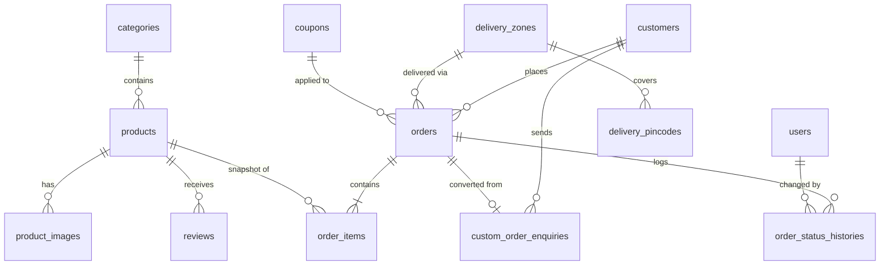

# Handmade Chocolate Store — Laravel 12

E-commerce website and order management system for a handmade chocolate business in Kolkata.
Laravel 12 · PHP 8.2 · MySQL 8 · Blade · Bootstrap 5.3 · vanilla JavaScript · Chart.js. No Node build step.

**Status:** storefront, checkout, orders and the full admin panel are built and tested (55 automated tests).
Covers phases 1–4 of the brief; see [What's included](#whats-included) and [Remaining before launch](#remaining-before-launch).

---

## Contents

1. [What's included](#whats-included)
2. [Architecture](#architecture)
3. [Database design](#database-design)
4. [Folder structure](#folder-structure)
5. [How ordering works](#how-ordering-works)
6. [Local installation](#local-installation)
7. [Deploying to Hostinger](#deploying-to-hostinger)
8. [Admin login and roles](#admin-login-and-roles)
9. [Testing](#testing)
10. [Remaining before launch](#remaining-before-launch)

---

## What's included

### Storefront (customers)

| Page | URL | What it does |
|---|---|---|
| Homepage | `/` | Banner slider, introduction, categories, bestsellers, gift boxes, custom-order panel, promises, reviews, Instagram grid, WhatsApp band — all managed from the admin |
| Shop | `/shop`, `/shop/{category}` | Search, category, price range, in-stock filter, sorting, pagination; filters update live without reloading (fetch) |
| Product | `/product/{slug}` | Photo carousel, price/sale, stock, ingredients, allergens, quantity, **Add to cart**, **Buy now**, WhatsApp enquiry, customer reviews + review form |
| Cart | `/cart` | Change quantities, remove, discount code, PIN-code delivery check with live totals |
| Checkout | `/checkout` | Contact, address, Kolkata local vs outside Kolkata, live delivery charge/date, UPI or cash on delivery |
| Order confirmation | `/order/{no}/thank-you` (signed link) | "Send order on WhatsApp" button, UPI ID + QR + "Pay with UPI app" link, payment reference and screenshot upload |
| Track order | `/track-order` | Order number + mobile → status timeline, courier and tracking number, updates |
| Custom orders | `/custom-orders` | Enquiry form with occasion, type, quantity, budget, date, PIN, message, reference image |
| Pages | `/page/about-us`, `faq`, policies | Editable in admin |
| Contact | `/contact` | WhatsApp, call, email, address, hours, social links |
| SEO | `/sitemap.xml`, `/robots.txt` | Generated automatically |

Phones get an app-style bottom bar (Home, Shop, Custom, Cart with badge, WhatsApp), a sticky "Add to cart" bar on product pages, toasts when items are added, and no sideways scrolling on any page.

### Admin panel (`/admin`)

| Module | Features |
|---|---|
| **Dashboard** | Revenue this month, today's / pending / completed / total orders, payments to verify, customers, products, out-of-stock; 12-month orders & revenue chart; needs-attention list; low stock; recent orders; setup checklist |
| **Orders** | Status tabs with counts, search (number / name / mobile), payment and date filters, CSV export; order page with items, customer, address; update status with note (shown to customer or internal); payment status + reference + screenshot; confirm courier charge; courier, tracking number/link, delivery date; internal notes; WhatsApp confirmation/status messages; history; printable invoice (GSTIN/FSSAI) |
| **Custom enquiries** | List with status and deadline warnings; details and reference image; status, quote, quote notes, internal notes; WhatsApp reply including the quote; **convert to order** |
| **Customers** | Search and sort by spend/orders; order history, total and average spend, enquiries; editable notes |
| **Products** | Search and filters; create/edit with category, SKU, slug, price, sale price, weight, description, ingredients, allergens, stock, featured/bestseller/gift/visible flags, SEO; multiple photos with main photo, order, description and removal |
| **Categories** | Name, slug, description, image, order, visibility, SEO; can't delete while it has products |
| **Coupons** *(owner)* | Percent or fixed, minimum order, cap, usage limit, start/end dates |
| **Reviews** | Approve, feature on homepage, add, edit, delete |
| **Homepage banners** | Headline, text, button, desktop + phone image, order; several become a slider |
| **Instagram gallery** | Upload photos linked to posts |
| **Pages** | Edit About/FAQ/policies (HTML is sanitised on save); add new pages |
| **Company setup** *(owner)* | Brand name, tagline, intro, logos, favicon, phones, WhatsApp, email, hours, address (with hide switch), GSTIN, FSSAI, social links, SEO, Analytics |
| **Store settings** *(owner)* | UPI on/off, UPI ID, payee name, QR code, instructions; COD on/off, Kolkata-only, limit; minimum order; local/same-day switches, Sunday closure, free-delivery amount; courier on/off, flat charge or "confirm later", free courier amount, estimate text; three WhatsApp message templates |
| **Delivery areas** *(owner)* | Zones with charge, free-delivery amount, same-day + cut-off time, lead days, customer note, and PIN codes pasted as a list |
| **Staff accounts** *(owner)* | Add owners or staff, disable, reset password |
| **My account** | Name, email, password |

---

## Architecture

Classic Laravel MVC, server-rendered with Blade, kept simple so it runs on shared hosting.

```
Browser ──► routes/web.php / routes/admin.php ──► Controller ──► Service ──► Eloquent ──► MySQL
                                                      │              │
                                               Form Request    CartService, OrderService,
                                               (validation)    DeliveryService, CouponService,
                                                               SettingService, WhatsAppService …
                                                      ▼
                                          Blade views + components ──► HTML (+ JSON for fetch())
```

| Layer | Responsibility |
|---|---|
| **Controllers** | Thin: read the request, call a service, return a view or redirect. Storefront and `Admin/` are separate. |
| **Form Requests** | All validation and input clean-up (mobile numbers → 10 digits, GSTIN upper-cased, PIN lists parsed). |
| **Services** | `CartService` (session cart, always fresh prices), `OrderService` (transactional order placement, status changes, stock), `DeliveryService` (PIN lookup, charge, same-day cut-off in IST), `CouponService`, `CatalogService` (shop queries), `SettingService` (cached settings), `CompanyProfile`, `WhatsAppService` (encoded click-to-chat links + templates), `ImageService` (resize/strip EXIF), `HtmlSanitizer`. |
| **SettingsSchema** | One definition per setting (label, input type, validation, default). Both settings screens, their validation and defaults are generated from it. |
| **Models** | Relationships, casts (enums for order/payment status), scopes and display helpers. |
| **Views** | Layouts, partials and anonymous components (`x-product-card`, `x-admin.input` …). No queries in templates. |

**WhatsApp** — all messages use click-to-chat links (`https://wa.me/<number>?text=…`, properly URL-encoded). They open WhatsApp with the text filled in and a person presses Send. Nothing is sent automatically; that would need the official WhatsApp Business API, which is not used.

**Payments** — no payment gateway. UPI is paid to the owner's account; the customer submits the UTR reference (and optional screenshot) and the owner marks it paid after checking.

**Hosting choices** — file sessions and cache, synchronous queue, public uploads written straight to `public/uploads` (no `storage:link` symlink), private uploads (payment screenshots, enquiry images) in `storage/app/private` and only viewable by signed-in staff, rupee formatting without the `intl` extension, `Asia/Kolkata` timezone.

**Security** — CSRF on every form; server-side validation everywhere; Eloquent bindings only; Blade escaping; sanitised page HTML; bcrypt passwords; login lockout (5 failures → 5 minutes); rate limits on checkout, payment, tracking, custom-order and review forms; honeypot fields; signed order-confirmation links; tracking needs order number **and** mobile; image-only uploads (JPG/PNG/WebP, size limits, SVG rejected); owner-only screens; security headers; `noindex` on admin and private pages; credentials only in `.env`.

---

## Database design

17 tables, `DECIMAL(10,2)` money, foreign keys and indexes, soft deletes on catalogue, customers, orders, coupons and enquiries.



| Table | Purpose |
|---|---|
| `users` | Owner and staff accounts (`role`, `is_active`, `last_login_at`) |
| `settings` | Every admin-editable setting, key/value, cached |
| `categories`, `products`, `product_images` | Catalogue |
| `customers` | One row per shopper, keyed by mobile — identity is not duplicated on orders |
| `orders` | Status, payment method/status/reference/screenshot, delivery address **snapshot**, totals, coupon, courier/tracking, source (website / enquiry) |
| `order_items` | **Snapshots** of name, SKU, weight and unit price, so old orders never change when products do |
| `order_status_histories` | Audit trail: who changed what, with notes visible to the customer or internal |
| `custom_order_enquiries` | Custom requests, quote and the order they became |
| `delivery_zones`, `delivery_pincodes` | Kolkata areas and serviceable PIN codes |
| `coupons` | Discount codes and usage counts |
| `reviews`, `banners`, `pages`, `gallery_items` | Content |

---

## Folder structure

```
app/
  Enums/                    OrderStatus, PaymentStatus
  Http/Controllers/         Home, Shop, Product, Review, Cart, Checkout, OrderConfirmation,
                            OrderTracking, CustomOrder, Page, Contact, Seo
  Http/Controllers/Admin/   Dashboard, Order, Enquiry, Customer, Product, Category, Coupon,
                            DeliveryZone, Review, Banner, Gallery, Page, Settings, User, Profile, Auth/Login
  Http/Middleware/          EnsureUserIsAdmin (admin, admin:owner), SecurityHeaders
  Http/Requests/            Checkout, CustomOrder, PaymentSubmission, TrackOrder, Review, ShopFilter
  Http/Requests/Admin/      Product, Category, Coupon, DeliveryZone, Enquiry, OrderUpdate, Content,
                            UpdateSettings, User, UpdateProfile, Login
  Models/                   17 models
  Services/                 Cart, Order, Delivery (+ DeliveryQuote), Coupon, Catalog, Setting,
                            CompanyProfile, WhatsApp, Image, HtmlSanitizer, SeoData
  Support/                  SettingsSchema, Slug, helpers.php (setting(), media_url(), money())
config/store.php            first-run brand values, admin account, admin URL prefix, page sizes
database/migrations/        6 migrations
database/seeders/           admin, settings, 3 categories + 15 products, pages, delivery areas,
                            banner + gallery, example coupon, demo reviews (local only)
public/assets/              store.css, store.js, admin.css, admin.js
public/images/placeholders/ SVG product illustrations used by the seeders
public/uploads/             owner-uploaded images
resources/views/            layouts, partials, components, home, shop, products, cart, checkout,
                            orders, track, custom-orders, pages, errors, admin/*
routes/web.php, admin.php
tests/Feature, tests/Unit   55 tests
```

---

## How ordering works

1. Customer adds products (cart stores only product IDs and quantities in the session; prices and stock are always read fresh).
2. In the cart or at checkout they enter a PIN code. **Kolkata**: the PIN must be in an active delivery area; charge comes from the area (free above its threshold); same day if the store and area allow it and it's before the area's cut-off in IST, otherwise the next available day (optionally skipping Sundays). **Outside Kolkata**: flat courier charge from settings, or "to be confirmed"; only an estimate is shown, never a guaranteed date.
3. Payment options adapt: UPI if enabled; COD if enabled, within the limit and (by default) only for Kolkata.
4. **Place order** runs in one database transaction: products are locked, stock is checked and reduced, the coupon is re-checked and counted, the customer is found or created by mobile, the order and item snapshots are saved, and a history entry is written. Two people can't buy the last box at once.
5. The customer lands on a private signed confirmation page with the WhatsApp "send order" button and UPI details, and can submit the payment reference.
6. The owner sees it on the dashboard, verifies payment, updates status (cancelling returns stock), adds courier details and sends WhatsApp updates from templates. The customer follows progress on the tracking page.

Custom enquiries follow their own path: form → admin quote → WhatsApp → **Convert to order**.

---

## Local installation

Requirements: PHP 8.2+ with `pdo_mysql`, `mbstring`, `openssl`, `fileinfo`, `gd`; Composer 2; MySQL 8.

```bash
composer install                     # platform pinned to PHP 8.2 in composer.json
cp .env.example .env
php artisan key:generate

mysql -u root -p -e "CREATE DATABASE chocolate_store CHARACTER SET utf8mb4 COLLATE utf8mb4_unicode_ci;"
# set DB_* and ADMIN_EMAIL / ADMIN_PASSWORD in .env

php artisan migrate --seed
php artisan serve                    # http://localhost:8000 · admin: /admin/login
```

Seeders are safe to re-run. Without `ADMIN_PASSWORD` (local only) a random password is printed once.

**Sample data:** 3 categories, 15 products (one sold out, one low stock), 6 pages, 3 Kolkata delivery areas with 30 PIN codes, a banner, 8 gallery tiles, an inactive `WELCOME10` coupon, and 4 clearly-labelled demo reviews (skipped in production). Product images are SVG placeholders — replace them in Admin → Products.

---

## Deploying to Hostinger

Works on Hostinger Premium/Business shared hosting with SSH.

1. **hPanel → Advanced → PHP Configuration:** PHP 8.2 or newer; enable `fileinfo`, `gd`, `pdo_mysql`.
2. **hPanel → Databases → MySQL:** create a database and user.
3. **Upload the code outside `public_html`**, e.g. `~/chocolate-store` (Git or File Manager zip upload).
4. **SSH:**
   ```bash
   cd ~/chocolate-store
   composer install --no-dev --optimize-autoloader
   cp .env.example .env
   nano .env   # APP_ENV=production, APP_DEBUG=false, APP_URL=https://yourdomain.com,
               # DB_*, ADMIN_EMAIL, ADMIN_PASSWORD, SESSION_SECURE_COOKIE=true
   php artisan key:generate
   php artisan migrate --seed --force
   ```
5. **Point the domain at `public/`:**
   ```bash
   mv ~/domains/yourdomain.com/public_html ~/domains/yourdomain.com/public_html_old
   ln -s ~/chocolate-store/public ~/domains/yourdomain.com/public_html
   ```
   If symlinks aren't allowed, copy the contents of `public/` into `public_html`, change the two paths in `public_html/index.php` to point at `~/chocolate-store/vendor/autoload.php` and `~/chocolate-store/bootstrap/app.php`, and set `UPLOADS_PATH` in `.env` to the full path of `public_html/uploads`.
6. `chmod -R 775 storage bootstrap/cache public/uploads`
7. `php artisan config:cache && php artisan route:cache && php artisan view:cache` (run `php artisan optimize:clear` first after any later change).
8. **hPanel → Security → SSL:** install the free certificate and force HTTPS.
9. Sign in, then fill in **Company setup**, **Store settings** (UPI ID!) and **Delivery areas**, and replace sample products and photos.

No cron job or queue worker is needed.

---

## Admin login and roles

| | |
|---|---|
| URL | `/admin/login` (change the prefix with `ADMIN_PATH`) |
| First account | `ADMIN_EMAIL` / `ADMIN_PASSWORD` from `.env` when you seeded |
| Owner | Everything |
| Staff | Orders, enquiries, customers, products, categories, reviews, banners, gallery, pages — not settings, coupons, delivery areas or accounts |
| Locked out | Wait 5 minutes after 5 wrong passwords |
| Forgotten password | `php artisan tinker --execute="App\Models\User::where('email','you@example.com')->first()->update(['password'=>'NewStrongPass123'])"` |

---

## Testing

```bash
php artisan test      # 55 tests, ~400 assertions, in-memory SQLite
```

Covers: homepage sections; shop filters, sort, pagination, JSON fragments; product pages; hidden products/categories; customer reviews; cart add/update/remove, stock caps, sold-out refusal, buy now; coupons (minimum, usage limit, counting); delivery quotes (local, unknown PIN, outstation pending/flat, same-day cut-off, free threshold); checkout (order + items + snapshots + stock + customer reuse, validation, COD rules, pending courier charge, empty cart); signed confirmation page and payment reference upload; order tracking; custom enquiries and honeypot; admin login, lockout, inactive accounts, staff restrictions, password change; every admin screen renders; product CRUD with photos; category deletion guard; order status/cancel restock/reopen block, payment, courier charge, shipping, notes, search, CSV; WhatsApp links; enquiry quote and conversion; delivery area PIN parsing and conflicts; coupons; reviews/banners/gallery/pages with HTML sanitising; company and store settings reaching the site; staff accounts; rupee formatting, WhatsApp number normalisation, HTML sanitiser.

### Manual checklist

**On a phone**
- [ ] No sideways scrolling; bottom bar works; cart badge updates after adding
- [ ] Product: quantity, Add to cart toast, Buy now goes to checkout, WhatsApp link includes the quantity
- [ ] Cart: change quantity, remove, apply a code, check a PIN (try 700029 and 110001)
- [ ] Checkout: switch Kolkata ↔ outside Kolkata; charge, date and payment options update; place the order
- [ ] Confirmation: Open WhatsApp, Copy UPI ID, Pay with UPI app (opens your UPI app), submit a reference
- [ ] Track order with the order number and mobile
- [ ] Send a custom order enquiry with a photo

**In the admin**
- [ ] Dashboard numbers and chart; checklist items tick off as you fill settings
- [ ] Open the order: mark paid, set Confirmed, add courier, send WhatsApp messages, print invoice
- [ ] Cancel a test order → stock goes back up
- [ ] Export orders to CSV and open in Excel
- [ ] Quote and convert the enquiry
- [ ] Add a product with photos; set the main photo; check it on the site
- [ ] Turn COD off / set a courier charge in Store settings → checkout reflects it
- [ ] Add a delivery area with your PIN codes and a same-day cut-off
- [ ] Create a staff account; sign in as staff; settings are hidden

---

## Remaining before launch

These need the owner or a hosting account rather than more code:

- Real brand name, logo, photos, UPI ID, FSSAI number, address and PIN codes (all in the admin).
- Review the policy pages, ideally with a lawyer.
- Delete the sample products and demo reviews.
- Run `composer install` with internet access to create `composer.lock`, then commit it.

Possible next additions if wanted: email notifications (Hostinger SMTP is already in `.env.example`), a payment gateway (Razorpay/PhonePe), stock-movement history, and WebP thumbnails.
