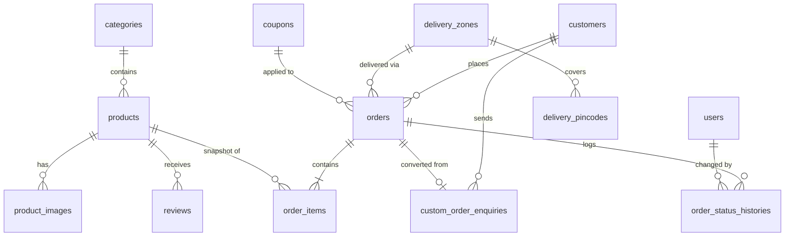

# Handmade Chocolate Store — Laravel 12

E-commerce website and order management system for a handmade chocolate business in Kolkata.
Laravel 12 · PHP 8.2 · MySQL 8 · Blade · Bootstrap 5.3 · vanilla JavaScript. No Node build step.

**Status: Phase 1 of 5 complete** (foundation, database, admin sign-in, company setup, storefront catalogue).
See [Phase plan](#phase-plan) for what comes next.

---

## Contents

1. [Architecture](#architecture)
2. [Database design](#database-design)
3. [Folder structure](#folder-structure)
4. [Company setup](#company-setup)
5. [Local installation](#local-installation)
6. [Deploying to Hostinger](#deploying-to-hostinger)
7. [Admin login](#admin-login)
8. [Testing](#testing)
9. [Phase plan](#phase-plan)

---

## Architecture

Classic Laravel MVC, server-rendered with Blade, kept deliberately simple so it runs on shared hosting.

```
Browser ──► routes/web.php ──► Controller ──► Service ──► Eloquent model ──► MySQL
              routes/admin.php      │             │
                                    ▼             ▼
                              Form Request    SettingService (cached)
                              (validation)    CompanyProfile / WhatsAppService
                                    │
                                    ▼
                              Blade view + components ──► HTML (+ JSON fragments for fetch())
```

| Layer | Responsibility |
|---|---|
| **Controllers** (`app/Http/Controllers`) | Thin: read the request, call a service, return a view. Storefront and `Admin/` are separate namespaces. |
| **Form Requests** (`app/Http/Requests`) | All validation and input normalisation (GSTIN upper-casing, FSSAI digits, filter sanitising). |
| **Services** (`app/Services`) | Business logic: `CatalogService` (filtering/sorting), `SettingService` (cached settings), `CompanyProfile` (formatted company identity for views), `WhatsAppService` (encoded click-to-chat links). |
| **SettingsSchema** (`app/Support`) | One definition per setting: label, input type, validation rules, default. The admin form, validation and defaults are all generated from it. |
| **Models** (`app/Models`) | Relationships, casts, query scopes and display accessors (effective price, stock status, image URLs). |
| **Views** (`resources/views`) | Blade layouts, partials and anonymous components. No queries or business rules inside templates. |
| **Assets** (`public/assets`) | Hand-written CSS and JS; Bootstrap 5.3 and Bootstrap Icons from jsDelivr. |

**Authentication.** One `web` guard. Only back-office users (role `admin` = owner, `staff`) can sign in; shoppers check out as guests and are stored in `customers`, so a customer can never reach the admin area. The `admin` middleware also signs out deactivated accounts, and `admin:owner` restricts owner-only screens such as Company setup.

**Why no separate `admins` table:** customers don't log in, so a second guard would add complexity with no benefit.

**Hosting choices.** File sessions and cache, synchronous queue, uploads written straight to `public/uploads` (no `storage:link` symlink, which some shared hosts block), Indian-rupee formatting without the `intl` extension, and `Asia/Kolkata` as the app timezone so delivery cut-offs are in IST.

**Security.** CSRF on every form, server-side validation, Eloquent bindings only, Blade auto-escaping, bcrypt passwords, login throttling (5 failures → 5-minute lockout per email + IP), named rate limiters for public forms and AJAX, image-only uploads (JPG/PNG/WebP, size-limited; SVG rejected), security headers, `noindex` on the admin, credentials only in `.env`.

---

## Database design

17 tables. All prices are `DECIMAL(10,2)`. Foreign keys and indexes on every lookup column.



| Table | Purpose | Notes |
|---|---|---|
| `users` | Owner and staff accounts | `role`, `is_active`, `last_login_at` |
| `settings` | Every admin-editable setting (company, contact, address, legal, social, SEO, later WhatsApp/UPI/delivery) | key/value with `group`; cached |
| `categories` | Product categories | slug, display order, active flag, SEO fields, soft deletes |
| `products` | Catalogue | SKU, price + discount price, weight, ingredients, allergens, stock, featured/bestseller/gift flags, soft deletes |
| `product_images` | Multiple photos per product | sort order, primary flag |
| `customers` | One row per shopper, keyed by mobile number | avoids duplicating identity on every order |
| `orders` | Orders | status, payment method/status/UPI reference, delivery address **snapshot**, totals, courier and tracking |
| `order_items` | Lines of an order | **snapshots** of name, SKU, weight and unit price so old orders never change |
| `order_status_histories` | Audit trail of status changes | who changed it and when |
| `custom_order_enquiries` | Personalised order requests | quote, notes, link to the order it became |
| `delivery_zones` | Kolkata areas | charge, free-delivery threshold, same-day flag and cut-off, lead days |
| `delivery_pincodes` | Serviceable PIN codes per zone | unique PIN |
| `coupons` | Discount codes | fixed/percent, minimum order, cap, usage limit, validity window |
| `reviews` | Customer reviews | approval and homepage-feature flags |
| `banners` | Homepage hero slides | separate mobile image |
| `pages` | About, FAQ and policy pages | editable HTML |
| `gallery_items` | Homepage Instagram-style grid | image + link, no API token needed |

The order address is stored on the order on purpose: it records where *that* order went, even if the customer later moves. Identity (name, mobile, email) lives once in `customers`.

---

## Folder structure

```
app/
  Enums/                 OrderStatus, PaymentStatus
  Http/
    Controllers/         Home, Shop, Product, Page, Contact, Seo
      Admin/             Dashboard, CompanySettings, Profile, Auth/Login
    Middleware/          EnsureUserIsAdmin, SecurityHeaders
    Requests/            ShopFilterRequest, Admin/{Login,UpdateCompanySettings,UpdateProfile}Request
  Models/                17 Eloquent models
  Services/              CatalogService, SettingService, CompanyProfile, WhatsAppService, SeoData
  Support/               SettingsSchema, helpers.php (setting(), media_url(), money())
config/store.php         first-run brand defaults, admin account, admin URL prefix
database/
  migrations/            users + 5 domain migrations
  seeders/               admin, settings, catalogue (3 categories, 15 products), pages, delivery zones, homepage
public/
  assets/css|js/         store.css, store.js, admin.css, admin.js
  images/placeholders/   SVG product and section illustrations used by the seeders
  uploads/               owner-uploaded images (logo, products…)
resources/views/
  layouts/app            storefront shell
  partials/              header, footer, mobile bottom nav, WhatsApp button, SEO tags
  components/            brand-logo, product-card, price, section-head
  home, shop/, products/, pages/, seo/, errors/
  admin/                 layouts/app, auth/login, dashboard, company/, profile/
routes/web.php           storefront
routes/admin.php         back office (prefix from ADMIN_PATH)
tests/                   Feature: storefront, admin auth, company setup · Unit: helpers
```

---

## Company setup

**Admin → Company setup** holds everything that identifies the business. Each tab saves together and appears on the website immediately.

| Tab | Fields | Where it shows |
|---|---|---|
| **Brand** | Brand name, tagline, short introduction, year started, logo for light backgrounds, logo for dark backgrounds, favicon | Header, footer, hero, admin, browser tab, WhatsApp messages, product schema |
| **Contact** | Primary and alternate phone, WhatsApp number, email, default WhatsApp greeting, business hours | Header call button, footer, contact page, every WhatsApp button |
| **Address** | Address lines, landmark, city, state, PIN, country, Google Maps link, *show full address publicly* switch | Footer, contact page, invoices (Phase 3). Hide it if you work from home — the site then shows only city and state. |
| **Legal & tax** | Registered business name, GSTIN (validated format), FSSAI licence number (14 digits), *show FSSAI in footer* switch | Footer, copyright line, invoices |
| **Social links** | Instagram (+ handle), Facebook, YouTube, X, Pinterest, LinkedIn, Google reviews page | Footer and contact-page icons (only filled ones show), homepage photo-grid heading |
| **SEO** | Homepage title and description, link-preview image, Google Search Console code, Google Analytics ID | `<head>` meta, Open Graph tags, analytics script |

A live footer preview updates as you type, the page warns before you leave with unsaved changes, and the dashboard shows a setup checklist until the essentials (name, logo, WhatsApp, address, FSSAI, Instagram) are filled in.

To add a setting later, add one entry to `app/Support/SettingsSchema.php`; the form, validation and `setting('key')` helper pick it up.

> FSSAI: food businesses selling online in India are required to display their FSSAI licence or registration number. Enter it before going live.

---

## Local installation

Requirements: PHP 8.2+ with `pdo_mysql`, `mbstring`, `openssl`, `fileinfo`, `gd`; Composer 2; MySQL 8.

```bash
# 1. Install dependencies (composer.json pins the platform to PHP 8.2,
#    so the lock file stays installable on PHP 8.2 hosting)
composer install

# 2. Environment
cp .env.example .env
php artisan key:generate

# 3. Database: create an empty MySQL database, then set DB_* in .env
mysql -u root -p -e "CREATE DATABASE chocolate_store CHARACTER SET utf8mb4 COLLATE utf8mb4_unicode_ci;"

# 4. Set ADMIN_EMAIL and ADMIN_PASSWORD in .env, then create tables and sample data
php artisan migrate --seed

# 5. Run
php artisan serve        # http://localhost:8000  ·  admin: http://localhost:8000/admin/login
```

Seeders are safe to re-run: they never duplicate rows or overwrite company settings you have edited.
Without `ADMIN_PASSWORD` (local only) a random password is generated and printed once.

**Sample data** (`database/seeders`): 3 categories, 15 products with prices, descriptions, ingredients and allergens, 6 information pages, 3 Kolkata delivery zones with PIN codes, a hero banner and gallery tiles. Product photos are SVG placeholders in `public/images/placeholders/` — replace them with real photography (product management arrives in Phase 3). Four clearly-labelled demo reviews are seeded **only outside production**.

---

## Deploying to Hostinger

Works on Hostinger Premium/Business shared hosting (hPanel) with SSH.

1. **hPanel → Advanced → PHP Configuration:** select PHP 8.2 (or newer). Enable `fileinfo`, `gd`, `pdo_mysql`.
2. **hPanel → Databases → MySQL:** create a database and user; note the names (Hostinger prefixes them, e.g. `u123456789_choco`).
3. **Upload the code** *outside* `public_html`, e.g. `~/chocolate-store` (Git: hPanel → Advanced → Git, or upload a zip with File Manager and extract).
4. **SSH in** (hPanel → Advanced → SSH Access) and run:
   ```bash
   cd ~/chocolate-store
   composer install --no-dev --optimize-autoloader
   cp .env.example .env
   nano .env        # APP_ENV=production, APP_DEBUG=false, APP_URL=https://yourdomain.com,
                    # DB_* from step 2, ADMIN_EMAIL / ADMIN_PASSWORD, SESSION_SECURE_COOKIE=true
   php artisan key:generate
   php artisan migrate --seed --force
   ```
5. **Point the domain at `public/`.** Either replace `public_html` with a symlink:
   ```bash
   mv ~/domains/yourdomain.com/public_html ~/domains/yourdomain.com/public_html_old
   ln -s ~/chocolate-store/public ~/domains/yourdomain.com/public_html
   ```
   or, if symlinks are not allowed, copy the contents of `public/` into `public_html` and edit the two paths in `public_html/index.php` to `__DIR__.'/../../chocolate-store/vendor/autoload.php'` and `.../bootstrap/app.php` (adjust to your folder). Uploads then live in `public_html/uploads`; set `'root' => base_path('../public_html/uploads')` for the `uploads` disk in `config/filesystems.php`.
6. **Permissions:** `chmod -R 775 storage bootstrap/cache public/uploads`
7. **Cache for speed:**
   ```bash
   php artisan config:cache && php artisan route:cache && php artisan view:cache
   ```
   Re-run these after every `.env` or code change (`php artisan optimize:clear` first).
8. **SSL:** hPanel → Security → SSL → install the free certificate and force HTTPS.
9. Sign in at `https://yourdomain.com/admin/login`, open **Company setup**, and replace every placeholder.

No cron job or queue worker is needed for Phase 1.

---

## Admin login

| | |
|---|---|
| URL | `/admin/login` (change the prefix with `ADMIN_PATH` in `.env`) |
| Email / password | `ADMIN_EMAIL` / `ADMIN_PASSWORD` from `.env` at the time you seeded |
| Change them | Admin → **My account** (current password required) |
| Locked out | After 5 wrong passwords, wait 5 minutes |
| Reset forgotten password | `php artisan tinker --execute="App\Models\User::where('email','you@example.com')->first()->update(['password'=>'NewStrongPass123'])"` |

---

## Testing

```bash
php artisan test        # 31 tests, 161 assertions
```

The suite runs on in-memory SQLite and covers: every homepage section, shop filters (search, price, stock, sort, invalid input), category pages, fetch/JSON filtering, pagination, product page and WhatsApp links, hidden inactive products/categories, information pages, 404, sitemap and robots; admin sign-in/out, wrong password, inactive accounts, rate limiting, staff vs owner permissions, password change; company setup saving and showing on the site, address hiding, validation messages, logo upload/removal and SVG rejection; rupee formatting and WhatsApp number normalisation.

### Manual checklist — Phase 1

**Storefront (try on a phone, a tablet and a laptop)**
- [ ] Homepage: hero, introduction, categories, bestsellers, gift boxes, custom-order panel, promises, reviews, photo grid, WhatsApp band, footer all render
- [ ] No sideways scrolling on any page at phone width
- [ ] Phone: bottom navigation is fixed; the active tab is highlighted; WhatsApp tab opens WhatsApp
- [ ] Header search opens, focuses the box and searches the shop
- [ ] Shop: category chips (phone) / sidebar (desktop); Filter button opens the drawer on phone
- [ ] Desktop: typing in search or price updates results without reloading; URL updates; Back button restores previous results
- [ ] Sort, "In stock only", pagination and "Clear filters" all work
- [ ] Product page: photo carousel and thumbnails, price with saving, stock label, quantity +/- capped at stock
- [ ] "Order on WhatsApp" opens WhatsApp with product, quantity and link pre-filled (change quantity first)
- [ ] Phone: sticky order bar appears once the main button scrolls away
- [ ] Sold-out product shows "Ask when it's back"
- [ ] Footer links: all six information pages and contact page open
- [ ] `/sitemap.xml` lists products; `/robots.txt` shows rules (production only allows indexing)

**Admin**
- [ ] `/admin` redirects to sign-in when signed out; wrong password shows an error
- [ ] Sidebar opens as a drawer on phone
- [ ] Company setup: change name, tagline, phone, WhatsApp, address → Save → website shows the new values
- [ ] Upload a logo (PNG) → appears in header; tick "Remove current image" → name returns as text
- [ ] Enter an invalid GSTIN → the Legal tab opens with the error message
- [ ] Turn off "Show full address" → contact page shows only city and state
- [ ] Add FSSAI number → appears in footer
- [ ] Add Instagram URL → icon appears in footer and contact page
- [ ] My account: change password with the current password; sign out and back in

---

## Phase plan

| Phase | Scope | Status |
|---|---|---|
| **1** | Project setup, full database schema, admin authentication, company setup, responsive storefront layout, homepage, catalogue with filters, product details, information pages, SEO basics | ✅ Done |
| **2** | Session cart, checkout, PIN-code delivery validation and charges, same-day cut-off, order creation in a transaction with stock reduction, UPI manual payment (reference + screenshot), COD switch, order confirmation, WhatsApp order notification, order tracking page | Next |
| **3** | Admin dashboard charts (Chart.js), product CRUD with multi-image upload, category CRUD, order management (status, payment, courier, notes, invoice print, CSV export), customer management | |
| **4** | Custom order form + enquiry management, delivery zone/PIN management, WhatsApp & UPI settings, coupons, reviews, banners, pages, gallery management | |
| **5** | Full test pass, security review, image optimisation, caching, production deployment | |

In Phase 1 the product page's order button sends the chosen chocolate and quantity to WhatsApp; the **Add to cart / Buy now** buttons arrive with the cart in Phase 2, so no button on the site is decorative.
